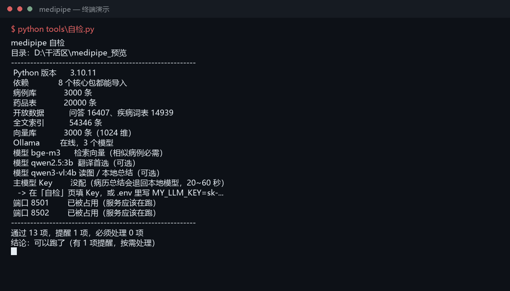
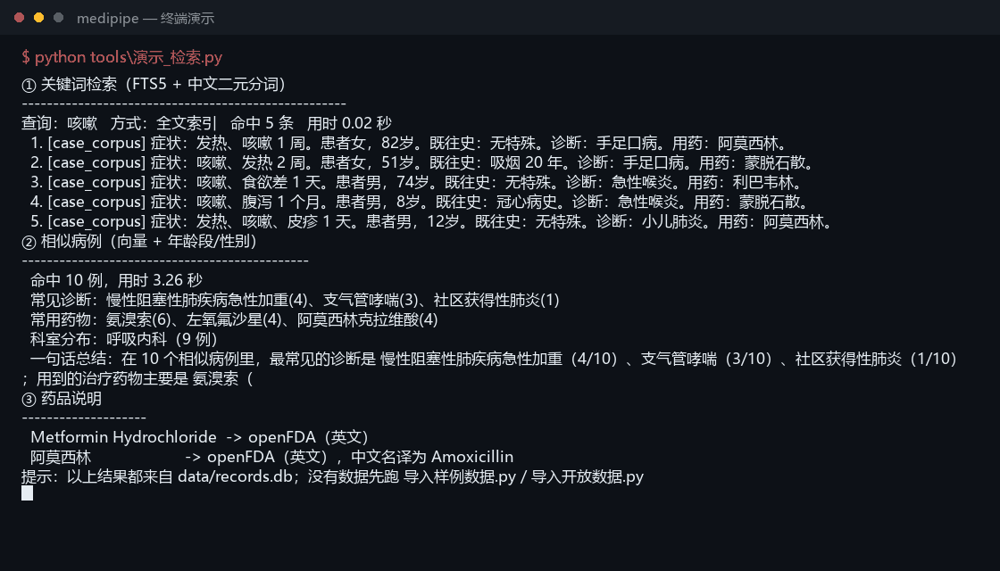
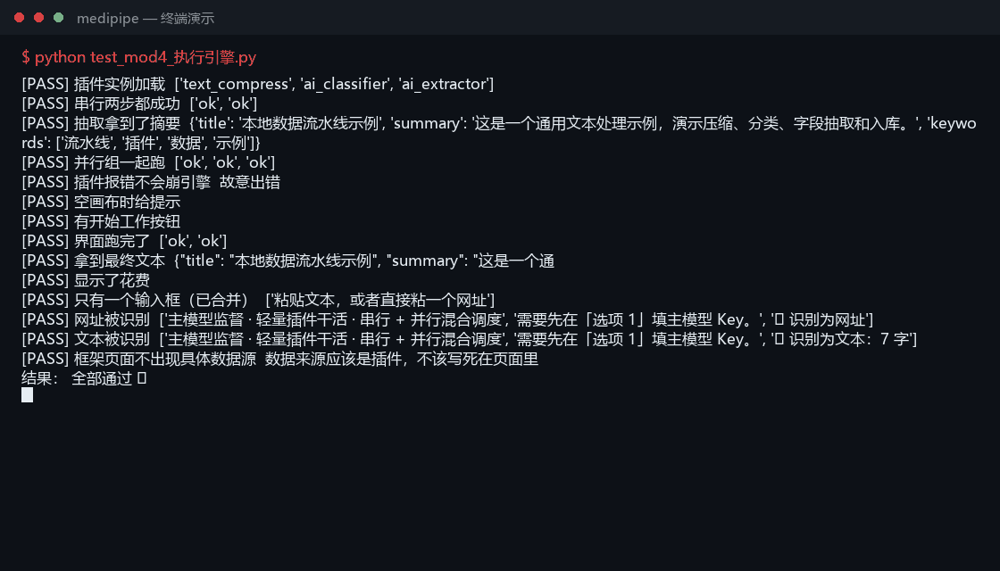

# 医疗数据流水线 · medipipe

> 一个**纯本地、离线可用**的医疗数据「生产 + 检索」双框架。
> 克隆下来就能跑：自带可自由分发的开放数据（药品说明书 + 医学问答 + 合成病例），
> 不强制任何商业 API Key，也不上传任何数据（只有「病历总结」想用主模型时才需要 Key）。

**框架 A** 负责把乱七八糟的数据抓进来、洗干净、写进库；
**框架 B** 负责把库里的东西查出来、看懂、翻译、总结。

> 🙋 **新人练手项目，欢迎指正。**
> 这是我第一次认真做一个开源项目，代码里一定有粗糙、甚至写错的地方：
> 命名土、注释多、有些地方明明有更简单的写法。
> 发现 bug、觉得哪里别扭、或者有更好的做法，**直接在 issue 里说就行，不用客气**，
> 哪怕只是提一句「这里是不是可以更简单」。

```text
原始数据 ──► 框架 A（插件流水线 / 画布编排） ──► SQLite + 向量 + 全文索引
                                                        │
                                                        ▼
                                        框架 B（检索 / 相似病例 / 总结 / 翻译）
```

## 先看三个演示（都是真跑出来的）

| 一键自检 | 检索效果 | 生产端流水线 |
|---|---|---|
|  |  |  |
| `python tools/自检.py` | `python tools/演示_检索.py` | `python test_mod4_执行引擎.py` |

GIF 是把真实命令输出录下来的，不是画的示意图；数字就是你跑那一刻库里的数字。
自己重新生成：`python tools/生成演示GIF.py`（需要 `pip install -r requirements-dev.txt`）。

## 文档

| 文档 | 讲什么 |
|---|---|
| [使用说明](docs/使用说明.md) | 从零装到跑起来，两个界面每个按钮干什么 |
| [插件接口](docs/插件接口.md) | 怎么写自己的插件（20 行起步） |
| [常见错误与修复](docs/常见错误与修复.md) | 按报错原文查：为什么 + 怎么修 |
| [数据说明](docs/数据说明.md) | 哪些是合成数据、哪些是公开数据、怎么验证 |

出问题先跑 `python tools/自检.py`，它会把环境/数据/模型/Key/端口挨个查一遍并告诉你下一步。

---

## 为什么做这个

- 医院数据和公开数据集（MIMIC-IV、eICU）都有使用协议，**不能随手放仓库、不能上网**；
- 现成的检索 demo 大多绑死某个云 API，断网就废；
- 想加一个新数据源，却要改一堆散落的脚本。

所以这里把「数据生产」和「数据检索」拆成两个独立程序，共用一份 SQLite：

- 生产端是**微内核 + 插件**：一个插件一个能力，拖到画布上连起来就跑；
- 检索端是**纯读**：不生产数据，只查；换库不用改代码；
- 一切离线：本地模型跑在 [Ollama](https://ollama.com)，没有网也能用。

---

## 仓库自带的数据（都可自由分发）

| 文件 | 条数 | 内容 | 许可 |
|---|---|---|---|
| `data/样例数据/病例样例.jsonl` | 204 | 合成病例，12 个科室，含症状/诊断/用药/年龄段/性别 | 本项目生成，无第三方版权 |
| `data/样例数据/症状样例.jsonl` | 53 | 各科室症状词表 | 本项目生成 |
| `data/开放数据/药品_openfda.jsonl` | 1000 | 药品说明书：品牌名、通用名、厂商、适应症、用法用量、警示 | **CC0-1.0**（美国公共领域，[openFDA](https://open.fda.gov)） |
| `data/开放数据/问答_medquad.jsonl` | 2000 | 医学问答（患者教育），来自 NIH 网站 | **CC BY 4.0**（[MedQuAD](https://github.com/abachaa/MedQuAD)，署名要求见文末） |

想自己再抓一份（数据会更新、也可以抓更多）：

```bash
# 仓库里只放了一小份（够跑通）；想喂饱检索，可以抓大的：
python tools/下载开放数据.py --openfda 20000 --medquad 0 --medquad-zip --doid 99999
python tools/导入开放数据.py --rebuild
```

> 演示站就是这么喂的：3,000 条合成病例 + 20,000 条 openFDA 药品 + 16,000 条 MedQuAD 问答 + 15,000 条疾病本体词表（全部是免费公开数据）。

**合成数据怎么证明是合成的？** 生成脚本就在仓库里（`tools/生成样例数据.py`，纯 `random`），
种子固定 `20260101`，任何人重跑都得到**逐字节相同**的文件：

```bash
python tools/生成样例数据.py
git diff data/样例数据/     # 应该没有任何变化
```

详细说明（含为什么不放真实病历）：[数据说明](docs/数据说明.md)。

> 真实病历（MIMIC-IV / eICU / 中文处方数据）受协议或版权限制，
> **本仓库不附带、不再分发**。怎么自己拿到并导入，见下面「接真实数据」一节。

> ⚠️ **数据量说明（很重要）**：仓库自带的数据**很少**——204 条合成病例、
> 1000 条药品说明书、2000 条问答，只够跑通链路、看清界面。
> 真正拿来搜的时候，**经常会出现搜不到结果**，这不是 bug，是库里确实没有那条数据。
> 想搜得准，请用 `tools/` 把自己的数据导进来（MIMIC/eICU 自行申请，或从 openFDA
> 多抓一些药品），数据越多、检索越有意义。

---

## 快速开始（5 分钟）

### 0. 先自检（可选，但省事）

```bash
python tools/自检.py
```

它会检查 Python 版本、依赖、数据库、向量、Ollama、模型、Key、端口，
哪项不合格就直接告诉你该敲什么命令。

### 1. 装依赖

```bash
python -m venv .venv
# Windows
.venv\Scripts\activate
# macOS / Linux
source .venv/bin/activate

pip install -r requirements.txt    # 版本全部锁死（==），和自己装出来的一致
```

Windows 也可以直接双击 `setup.bat`。

### 2. 装本地模型（可选，但推荐）

```bash
ollama pull bge-m3        # 检索向量（1024 维），相似病例必需
ollama pull qwen2.5:3b    # 翻译首选：非思考模型，一个词名约 0.2 秒
ollama pull qwen3-vl:4b   # 读图 / 没 Key 时的本地总结（慢），可选
```

没装 Ollama 也能启动：「概览」「关键词检索」照常工作，「药品说明」查 openFDA 也照常；
「相似病例」「翻译」「图片读图」需要 Ollama。
「病历总结」默认走主模型，需要在「自检」页填 Key（DeepSeek 等），
没 Key 时会提示，也可以勾选「用本地模型」凑合（慢）。

### 3. 导入数据

```bash
# 合成病例 → case_corpus，并建向量（约 20 秒）
python tools/导入样例数据.py

# 开放数据 → drugs / medquad_qa，并建全文索引（约 1 秒）
python tools/导入开放数据.py
```

### 4. 启动

```bash
# 检索端
python -m streamlit run framework_b/app_b.py --server.port=8502

# 生产端（另一个窗口）
python -m streamlit run app.py --server.port=8501
```

Windows 双击 `2_启动框架B_检索.bat` / `1_启动框架A_生产.bat` 也行。

打开 <http://127.0.0.1:8502>，进「相似病例」试试：

```
① 哪里不舒服：胸部
② 怎么不舒服：咳嗽咳痰、发热三天
③ 既往病史：吸烟20年
```

---

## 框架 B · 检索端

五个标签页，都不写数据，只读库。

| 标签页 | 做什么 |
|---|---|
| **概览** | 库里有几张表、多少行、索引在不在；一眼看出环境是否就绪 |
| **相似病例** | 部位多选 + 自由描述 + 既往史 → 向量检索 → 结果分五个子页：类似疾病 / 治疗药物 / 常用药物 / 总结 / 查看病例 |
| **关键词检索** | 中文二元分词 + FTS5 倒排 + BM25，毫秒级；没有索引自动退回 LIKE |
| **病历总结** | 粘文本或上传图片 → 主诉 / 现病史 / 既往史 / 关键检查 / 诊断 / 处理 六段。**走主模型，需要 Key**（2~5 秒）；没 Key 可勾选退回本地模型（20~60 秒） |
| **自检** | 数据库、模型、Key 状态一次看完 |

几个细节：

- **年龄段 / 性别筛选**：男性不会返回妇产科病例，年龄按 `0-17 / 18-44 / 45-64 / 65+` 分带；
- **多来源等权**：不同表的数据量差几个数量级，先按来源取 Top-K 再合并，避免大表把结果全占了；
- **结果翻译**：中英一键切换、可恢复原文；译文带数字校验（`0.9%` 不会被翻成 `9%`）和语言校验，
  翻英文时若模型原样返回中文，会重试而不是把坏结果写进缓存；
- **药品说明**：中文说明书优先，没有就查 openFDA，再没有就统计病例库里出现过几次。

一句话架构：

```text
b_相似.py   向量 + 统计 + 详情      b_检索.py   FTS / LIKE 兜底
b_药物.py   疾病 → 药物             b_说明.py   药名 / 病名 → 说明
b_总结.py   六段式总结              b_翻译.py   中英互译（带缓存）
b_分词.py   中文二元分词            b_核心.py   自检 / 路由
```

---

## 框架 A · 生产端

微内核 + 插件，三页流程：**配主模型 → 画布编排 → 开始工作**。

- **插件制**：`plugins/` 下一个文件一个能力，继承 `BasePlugin`、实现 `execute()` 就能接入；
- **画布编排**：拖节点、连线条，节点可设出入方向，支持一进多出；
- **节点协议**：插件声明 `REQUIRES` / `OUTPUT_FIELDS`，开跑前先校验上游字段，
  连错线立刻报错，而不是跑到一半炸；
- **执行引擎**：串行 / 并行、每步超时、失败即停（下游标 `skipped`）、条件重试、
  子进程隔离（超时可硬杀）、降级状态；
- **可观测**：`data/app.log` 是 JSON 行，界面有状态色，报错翻译成人话。

### 写一个插件

`plugins/my_plugin_我的插件.py`：

```python
# -*- coding: utf-8 -*-
from base_基类 import BasePlugin


class MyPlugin(BasePlugin):
    name = "我的插件"
    REQUIRES = ["text"]           # 需要上游给什么字段
    OUTPUT_FIELDS = ["text"]      # 自己产出什么字段

    def execute(self, text_data: str) -> str:
        # 拿到上一步的输出，返回新的字符串
        return text_data.replace("\r\n", "\n").strip()
```

放到 `plugins/` 下，重启框架 A，画布左侧就会出现它。

---

## 目录

```text
app.py                  框架 A 入口（十几行，只负责启动外壳）
config_配置.py           路径、超时、批量上限、模型目录
core/                   执行引擎、加载器、扫描器、日志、重试、节点协议
ui/                     框架 A 三页 + 画布
plugins/                生产端插件（抓取 / 抽取 / 入库 / 药品 / OCR …）
framework_b/            框架 B：检索应用
tools/                  导入、建库、建索引、建向量、样例生成、开放数据下载、爬虫、自检
data/样例数据/           合成病例 + 症状词表
data/开放数据/           openFDA 药品 + MedQuAD 问答
docs/                   使用说明 / 插件接口 / 常见错误 / 数据说明 + 演示 GIF
test_*.py               验收脚本（不花钱、不联网）
```

---

## 常用命令

```bash
python tools/自检.py              # 环境/数据/模型/Key/端口 全查一遍
python tools/看总体状态.py        # 库多大、哪些表有数据
python tools/演示_检索.py          # 命令行看检索效果（不用开界面）
python tools/建搜索索引.py        # 重建全文索引（FTS5 + 二元分词）
python tools/建向量.py            # 建/续建向量（追加写，可断点续跑）
python tools/清翻译缓存.py         # 检查并清理坏译文
python tools/导入开放数据.py --rebuild   # 重导开放数据
```

---

## 接真实数据

| 数据 | 获取方式 | 注意 |
|---|---|---|
| MIMIC-IV | [PhysioNet](https://physionet.org) 申请 + 培训 + DUA | 禁止再分发，别提交到仓库 |
| eICU-CRD | 同上 | 同上 |
| MIMIC-IV-Note | 同上 | 出院小结，含自由文本 |
| Huatuo / CMB 等中文集 | 各自许可证 | 看清是否允许再分发 |
| 中国医药信息查询平台 | `tools/爬dayi.py`（遵守 robots） | 内容有版权，**仅限本地研究** |

导入示例：

```bash
python tools/从zip导入.py --zip MIMIC-IV.zip --prefix miv
python tools/建病例库.py 100000
python tools/建搜索索引.py
python tools/建向量.py
```

跑完这些，框架 B 的「概览」会看到新表。要注意：

- 「相似病例」只读 `case_corpus` 和向量文件，所以先跑 `建病例库.py`（把 MIMIC/eICU 聚合成病例库）
  再跑 `建向量.py`；
- 「关键词检索」默认只扫 `framework_b/b_检索.py` 里 `DEFAULT_TABLES` 列出的表
  （防止在几亿行的库上全表 LIKE 卡死）。想搜别的表，把表名加进那个列表，或直接调
  `b_检索.search(..., all_tables=True)`。

---

## 测试

```bash
python test_mod1_外壳.py
python test_mod4_执行引擎.py
python test_mod7_入库.py
python test_url_safety.py
python test_b_框架B.py

# 界面全流程（真的去点按钮，需要先导入数据）
python tools/测_A界面.py
python tools/测_B界面.py
```

每个脚本自断言，末尾打印 `结果：全部通过`。这些测试不联网、不花钱。

---

## 常见问题

**Q：没装 Ollama 会怎样？**
能启动、能搜关键词、能看药品说明；相似病例、翻译、读图会提示「模型不可用」而不是崩掉。
病历总结会直接走主模型（需要 Key）。

**Q：病历总结为什么非要 Key？**
本地 4B 模型是思考模型，一份病历要 20~60 秒；主模型 2~5 秒，质量也更好。
所以默认走主模型。真没 Key，页面上可以勾「用本地模型」凑合。
Key 填在「自检」页，和框架 A 共用 `.env` 里的 `MY_LLM_KEY`。

**Q：第一次点翻译很慢？**
本地模型首次加载要十几秒。之后有磁盘缓存，常见病名/药名 0.0 秒返回。
想提前热一遍：`python tools/预热翻译.py 1500 300`。

**Q：相似病例搜不到东西？**
先看是不是数据太少：仓库自带 204 条合成病例、1000 条药品，**搜不到很正常**。
再检查 `data/case_vectors.bin` 和 `bge-m3` 是否都在，并跑过 `python tools/导入样例数据.py`。
想搜到更多，把真实数据导进来（见「接真实数据」）。

**Q：能换成别的模型吗？**
检索向量维度要一致（bge-m3 是 1024 维）；翻译模型改 `framework_b/b_翻译.py` 里的
`TRANSLATE_MODELS`；总结用的主模型在 `framework_b/b_配置.py` 里改 `BASE_URL` / `MODEL`，
Key 在「自检」页填。

**Q：数据会不会上传？**
不会。除了你自己发起的抓取请求（openFDA / dayi / 数据集下载），没有任何外发流量。

---

## 许可

**免费开源，禁止商用。** 代码采用《非商业使用许可 1.0》(Non-Commercial License 1.0)，
全文见 [LICENSE](LICENSE)。简单说：

- ✅ 可以免费获取、运行、修改、分发、用于学习与研究
- ✅ 分发时保留本许可与版权声明即可
- ❌ 不得用于商业用途（含对外收费服务、付费产品内置、商业项目交付）

仓库内各数据的授权**与代码许可分开**：

| 数据 | 授权 |
|---|---|
| 合成病例、症状词表 | 本项目生成，随代码同一许可 |
| `药品_openfda.jsonl` | CC0-1.0（美国公共领域） |
| `问答_medquad.jsonl` | CC BY 4.0，需保留署名 |
| `疾病词表_doid.jsonl`（可选下载） | CC BY 4.0（[Disease Ontology](https://github.com/DiseaseOntology/HumanDiseaseOntology)），需保留署名 |
| 你自己导入的 MIMIC / eICU / dayi 数据 | 遵守各自协议，**不在本仓库许可范围内** |

---

## 致谢与引用

- 药品说明书数据来自 **openFDA**（U.S. Food and Drug Administration），公共领域 / CC0 1.0：
  <https://open.fda.gov>
- 医学问答数据来自 **MedQuAD**（Medical Question Answering Dataset），CC BY 4.0：
  <https://github.com/abachaa/MedQuAD>

  > Ben Abacha, A., & Demner-Fushman, D. (2019).
  > *A Question-Entailment Approach to Question Answering.*
  > BMC Bioinformatics, 20(1), 511.

- 疾病词表来自 **Disease Ontology**，CC BY 4.0：
  <https://github.com/DiseaseOntology/HumanDiseaseOntology>

  > Schriml LM, et al. *Human Disease Ontology 2024 update.* Nucleic Acids Research.

- 向量检索用 **bge-m3**，本地推理用 [Ollama](https://ollama.com)，界面用 [Streamlit](https://streamlit.io)。

如果这个项目对你有帮助，Star 一下就好。

---

## 欢迎指正

本人是**新手**，这是练手 + 想真解决自己问题做出来的东西。已知不完美：

- 代码风格不统一（有些地方中文注释比代码还长）
- 性能只在自己这台机器上验证过，换环境可能慢
- 文档是按自己的理解写的，别人未必一看就懂
- 边界情况肯定还有没覆盖到的

**看到问题欢迎提 issue，或者直接 PR。** 说得越具体越好（复现步骤、报错、
你的环境），我会认真看。觉得哪里设计得蠢，也可以直说。
